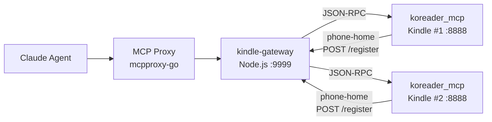
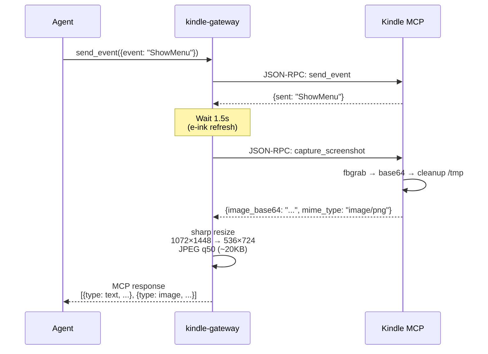
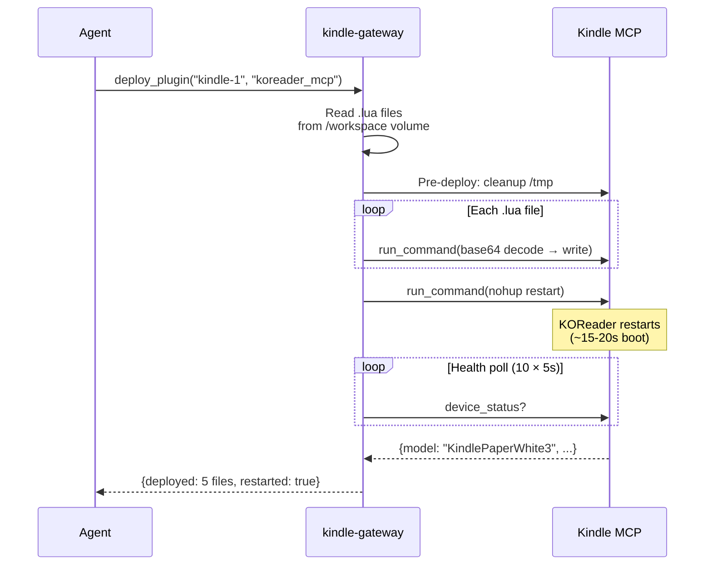
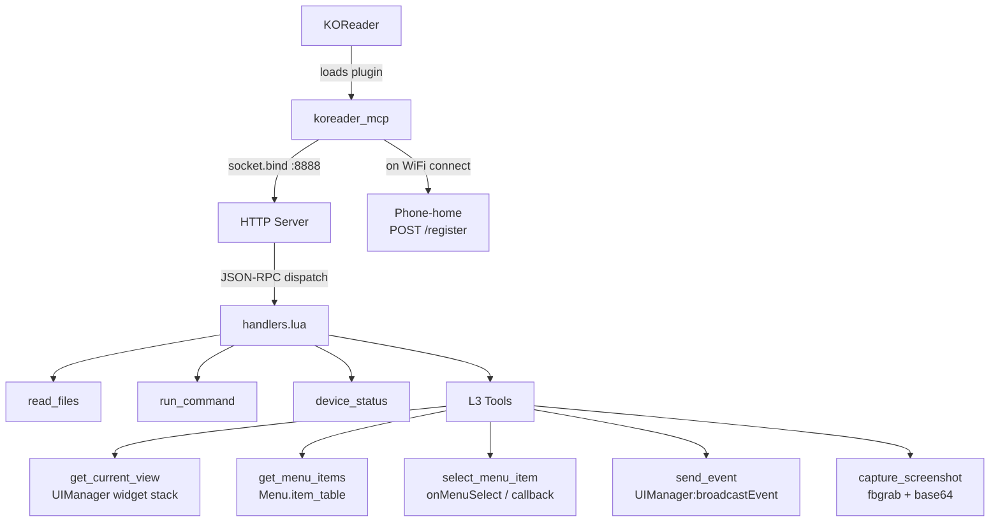

# koreader-ppw3

KOReader plugin development workspace + MCP device bridge for a fleet of Kindle Paperwhite 3 devices.

## What This Is

An autonomous agent dev loop for KOReader e-reader plugins. Edit Lua code, deploy to real Kindles over WiFi, navigate the UI programmatically, and verify with screenshots — all through MCP tool calls. Zero manual intervention.

## Architecture

### System Overview



### Screenshot-in-Response Pipeline

Every L3 tool call returns the action result **plus** a native screenshot of the resulting UI:



### Deploy + Restart Flow



## Tools (13 total)

### Base Tools
| Tool | Description |
|------|-------------|
| `list_devices` | List registered Kindle devices + status |
| `read_files` | Read files from Kindle filesystem |
| `run_command` | Execute shell commands on Kindle |
| `device_status` | Battery, model, screen, WiFi info |

### L3 Semantic UI Tools (all return screenshot)
| Tool | Description |
|------|-------------|
| `get_current_view` | Widget stack introspection |
| `get_menu_items` | List items in visible menu |
| `select_menu_item` | Select by text (substring) or index |
| `go_back` | Navigate back in menu stack |
| `close_top_widget` | Dismiss dialogs/messages |
| `send_event` | Trigger KOReader events (ShowMenu, etc.) |

### Device Management
| Tool | Description |
|------|-------------|
| `screenshot` | Standalone capture (resized JPEG) |
| `restart_koreader` | Kill + restart + health poll |
| `deploy_plugin` | Transfer .lua files + restart |

## koreader_mcp.koplugin

Lua HTTP + JSON-RPC server running inside KOReader on the Kindle.



Key implementation details:
- **FD_CLOEXEC** on listening socket via LuaJIT FFI — prevents child processes from inheriting port 8888
- **Auto /tmp cleanup** after screenshot capture (Kindle has 64MB tmpfs)
- Runs on Lua 5.1 (LuaJIT) with luasocket for HTTP

## Project Structure

Plugins live at workspace root as `<name>.koplugin/` directories. The kindle-gateway mounts the workspace root as `/workspace` (read-only) and reads plugins directly from there — no `dev/` subdir convention.

```
├── koreader_mcp.koplugin/        # MCP server plugin (Lua)
│   ├── handlers.lua             # All tool handlers (L3 + base)
│   ├── server.lua               # HTTP + JSON-RPC server
│   └── main.lua                 # KOReader plugin entry point
├── rssreader.koplugin/           # FreshRSS reader plugin (own git repo — see remotes)
├── kindle-gateway/               # MCP relay gateway (Node.js/TypeScript)
│   ├── src/
│   │   ├── gateway-server.ts     # 13 tools + forwardWithScreenshot
│   │   ├── kindle-client.ts      # JSON-RPC client (configurable timeout)
│   │   └── device-registry.ts    # In-memory device registry
│   ├── Dockerfile                # node:22-slim + sharp
│   └── docker-compose.yml        # network_mode: host, workspace volume
├── scripts/                      # Deploy scripts (shell-side fallbacks for the MCP deploy_plugin tool)
└── kosettings_backup/            # Device settings reference
```

## Quick Start

### Deploy plugin to Kindle

**Plugin discovery:** the gateway treats any `<name>.koplugin/` directory at workspace root as deployable. Pass the bare name (no `.koplugin` suffix) as the `plugin` arg. To add a new plugin, drop the dir at workspace root and it's immediately deployable.

```bash
# Via MCP tool (preferred — handles /tmp cleanup + restart + health poll):
kindle-gateway__deploy_plugin(device: "kindle-1", plugin: "koreader_mcp")
kindle-gateway__deploy_plugin(device: "kindle-1", plugin: "rssreader")

# Manual fallback (matches what deploy_plugin does internally):
scp koreader_mcp.koplugin/*.lua root@<kindle-ip>:/mnt/us/koreader/plugins/koreader_mcp.koplugin/
ssh root@<kindle-ip> 'killall luajit && cd /mnt/us/koreader && ./koreader.sh &'
```

**Known limitation:** the inline base64 transfer in `deploy_plugin` has an ARG_MAX cap on BusyBox shell (~48KB raw / ~64KB base64). Files above that silently truncate while still reporting success. For large files, fall back to a thinkpad-side `python3 -m http.server` + `wget` from kindle, or use the `scripts/deploy-rssreader.sh` tarball path.

### Rebuild gateway
```bash
cd kindle-gateway
npx tsc --noEmit                    # typecheck
PORT=9998 npx tsx src/index.ts      # local dev test first!
# verify tools: curl localhost:9998/health
docker compose build && docker compose up -d

# Reconnect proxy + approve new tools
curl -s -X POST -H 'X-API-Key: <key>' localhost:8888/api/v1/servers/kindle-gateway/restart
curl -s -X POST -H 'X-API-Key: <key>' -H 'Content-Type: application/json' \
  -d '{"approve_all": true}' localhost:8888/api/v1/servers/kindle-gateway/tools/approve
```

### Agent interaction example
```
→ send_event(device: "kindle-1", params: '{"event": "ShowMenu"}')
← {sent: "ShowMenu"} + [screenshot of KOReader menu]

→ select_menu_item(device: "kindle-1", params: '{"text": "FreshRSS"}')
← {selected_text: "FreshRSS", action: "invoked_callback"} + [screenshot]

→ get_menu_items(device: "kindle-1")
← {items: [...], total_items: 7} + [screenshot]
```

## Known Patterns & Anti-Patterns

| Pattern | Why |
|---------|-----|
| Use `send_event` for UI navigation | `evemu-event` (raw touch) froze 2 Kindles |
| Never nest curl through Kindle MCP | Single-threaded Lua deadlocks on self-calls |
| Hot dev loop: PORT=9998 first | Avoids proxy disruption during iteration |
| FD_CLOEXEC on server socket | Prevents port 8888 zombie after restart |
| Pre-deploy /tmp cleanup | 64MB tmpfs fills from fbgrab dumps |
| Approve tools after gateway rebuild | Proxy auto-quarantines new/changed tools |

## Kindle Fleet

2× Kindle Paperwhite 3, jailbroken, USBNet (OpenSSH port 22), KOReader v2025.04.

## License

GNU Affero General Public License v3.0, the same license as KOReader. See [LICENSE](LICENSE).
