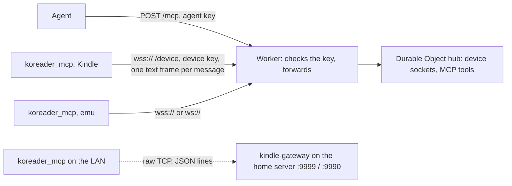

# Device bridge

There are two gateways that speak the same device protocol and serve the same MCP tools:

- `kindle-gateway-worker/` (the main one): a Cloudflare Worker at `https://kindle.kenluu.org`. Agents call `POST /mcp` with `Authorization: Bearer <agent key>`; devices open a WebSocket to `wss://kindle.kenluu.org/device` with `Authorization: Bearer <device key>`. One Durable Object named `hub` holds every device's socket and runs the tools. Why: decision record 0006.
- `kindle-gateway/` (LAN fallback, Node in Docker on the home server, until every Kindle has moved): MCP on port 9999, devices on raw TCP to `DEVICE_PORT` 9990, no keys.

`koreader_mcp` (Lua, inside KOReader) dials out during a live session and keeps that one connection open; tool calls and replies travel over it. A device is in `list_devices` exactly while its connection is open; neither gateway stores a device list anywhere else. Devices listen on nothing.

## The connection

Two transports carry the same JSON messages. Given `host:port`, the device dials raw TCP and sends newline-delimited JSON. Given a `ws://` or `wss://` URL, it opens a WebSocket (`ws.lua`, RFC 6455, no native library) with `Authorization: Bearer <device key>` on the handshake and sends one message per text frame; `wss://` goes through LuaSec with the peer certificate checked against `data/ca-bundle.crt` and the host name (SAN, else CN). `live.lua` sees no difference: the WebSocket connection offers the same `receive("*l")` and `send` as a luasocket.

The device sends a hello (`name`, `id_hash`, versions); the gateway answers `welcome` or `refused`. Then the gateway sends JSON-RPC calls and the device replies by id, in any order. The device pings every 60 s with the fixed text `{"type":"ping"}` and the gateway answers `{"type":"pong"}`; the body never varies, so a WebSocket gateway can answer it without waking up. Either side treats 150 s of silence as a drop. A WebSocket control ping is answered with a control pong; a close frame drops the connection.

- Where the device dials: `gateway_url` and `gateway_key` in `<settings>/koreader_mcp.lua` (set from the menu: Agent bridge, Gateway address, which takes `host:port` or a URL, and Device key), else `gateway_url` and `gateway_key` in the plugin's `config.lua` (the emulator writes these from `MCP_GATEWAY_URL` and `MCP_GATEWAY_KEY`), else `host:port` from the same places. A host and port saved from the menu beat a URL in `config.lua`. With a WebSocket gateway, Send diagnostics goes to the gateway's own http(s) origin and carries the same bearer key.
- A WebSocket handshake answered 401 or 403 means the key was turned down: a Kindle session ends, and `always` mode logs `live mode rejected` and waits 300 s (`Live.REJECTED_DELAY`) before trying again, never the short retry delays, so a wrong key cannot hammer the gateway.

- A name is refused only while a different `id_hash` holds it on an open connection. The same hash replaces the old connection, which covers a reconnect the gateway has not noticed yet.
- `id_hash` is the first 12 hex digits of a SHA-256 of the serial; the serial itself never leaves the device, only its last 4 characters in the default name `pw3-XXXX`.
- A session starts from the menu (Agent bridge, Live mode) and ends on 15 minutes without an agent command, battery below 30%, the menu, or failing to reconnect after 5 s, 15 s and 60 s. `session_open` in `<settings>/koreader_mcp.lua` resumes a session after a kill. `live_mode = "always"` in the plugin's `config.lua` starts the session at boot, never ends it and retries every 60 s, unless Live mode was turned off in the menu, which saves `live_off` in `<settings>/koreader_mcp.lua` and holds across restarts until it is turned back on; the emulator and both Kindles run this way, so nobody toggles live mode to develop. With live mode off nothing dials out and the agent cannot reach the device at all.
- During a session on a Kindle: `preventScreenSaver` is held and KOReader's WiFi auto-off check is paused; both are put back at the end. This does the Keep alive plugin's job, so it is not needed (and a hold it set is left alone); the cost is that a Kindle in `always` mode never sleeps by itself. The socket is checked every 0.2 s within 10 s of an agent command, else every 2 s.
- The socket is `FD_CLOEXEC`: otherwise the detached restart shell inherits it and the gateway never sees the device go.
- Connecting blocks the UI for up to 5 s per attempt; accepted because it only happens during a session.

## The hub on Cloudflare

- The Worker (`src/index.ts`) only checks the bearer key and forwards: `GET /health` answers `ok`; `GET /device` needs the device key and a WebSocket upgrade (426 otherwise); `POST /mcp` needs the agent key (`GET` and `DELETE /mcp` get 405 from the SDK); `PUT /inbox/...` needs the device key. A missing or wrong key is 401. Keys are compared by hashing both sides (`src/auth.ts`), and an unset or empty key never matches.
- The hub accepts each socket with the Hibernation API (`ctx.acceptWebSocket`), so the runtime keeps the socket while the object is evicted from memory. Per-socket state (connect time, last message, remote address, and after the hello the name, `id_hash` and versions) is kept with `serializeAttachment`, capped at 2,048 bytes.
- The constructor registers `{"type":"ping"}` and `{"type":"pong"}` as an auto-response pair, so the 60 s ping is answered without waking the object. A ping that differs in any byte still gets a pong, but wakes it.
- While any socket is open an alarm runs every 5 minutes (`SWEEP_INTERVAL_MS`) and closes sockets that sent no hello within 10 s or nothing, ping included, for 150 s. Each run wakes the object once; that is the only idle cost.
- Pending agent calls and the reconnect waiters for `restart_koreader` live in memory, which is fine because the object stays awake while it serves a call. A reply must come within 10 s by default; a device must reconnect within 60 s after a restart.
- `remoteAddress` in `list_devices` comes from `CF-Connecting-IP`, so it is the network's public address, not the device's LAN address.
- Config: `wrangler.jsonc` binds `HUB` (the Durable Object, SQLite-backed because the free plan offers no other kind) and `INBOX` (R2 bucket `kindle-gateway-inbox`), sets `EINK_DELAY_MS` to 1500, and turns `workers_dev` off so the custom domain is the only way in. The secrets `AGENT_KEY` and `DEVICE_KEY` are set with `npx wrangler secret put`, or in `.dev.vars` (gitignored) for `npx wrangler dev`.

Line numbers below are a starting point, not an address: jump roughly there, confirm by what the code says, and fix and re-date this page if a range is off by more than a screen.

| file | lines | what lives there |
|---|---|---|
| `kindle-gateway-worker/src/index.ts` | whole file | routes, key checks, forwarding to the one `hub` object |
| `kindle-gateway-worker/src/auth.ts` | whole file | `bearerMatches`, constant-time key check |
| `kindle-gateway-worker/src/hub.ts` | 7-40 | ping and pong text, hello, silence, sweep and call timeouts, the socket attachment |
| same | 101-138 | constructor (auto-response), WebSocket accept, `serveMcp` |
| same | 140-204 | what the tools call: `listDevices`, `call`, `waitForReconnect` |
| same | 206-258 | Hibernation API handlers and the sweep `alarm` |
| same | 260-365 | hello check, reply routing, attachment save, drop and close |
| `kindle-gateway-worker/src/mcp.ts` | whole file | `ToolContext`, `toolSets` (one line per tool group), stateless MCP handler |
| `kindle-gateway-worker/src/tools/device-tools.ts` | 32-137 | the 18 device tools |
| same | 139-294 | forwarding, screenshot after a UI tool, `screenshot`, `restart_koreader` |
| `kindle-gateway-worker/src/screenshot.ts` | whole file | resize to 536x724 grayscale JPEG with photon (WebAssembly) |
| `kindle-gateway-worker/src/inbox.ts` | whole file | `PUT /inbox/<device>/<file>` into R2 |
| `kindle-gateway-worker/src/diagnostics-tools.ts` | whole file | `list_diagnostics`, `read_diagnostics` from R2 |
| `kindle-gateway-worker/test/` | | vitest in workerd: `hub.test.ts`, `mcp.test.ts`, `inbox.test.ts` |
| `kindle-gateway/src/device-protocol.ts`, `ui-snapshot.ts` | whole file | hello validation, reply detection and the stale snapshot reference check, imported by the Worker as well |
| `kindle-gateway/src/gateway-server.ts` | 1-62 | LAN fallback: env (`PLUGINS_SRC`, `EINK_DELAY`) and screenshot resize with `sharp` |
| same | 63-240 | `/health` and tool definitions (21 tools, `deploy_plugin` included) |
| same | 241-262 | stateless MCP transport on `/mcp` |
| same | 273-501 | forwarding, screenshot after a UI tool, diagnostics tools, `captureScreenshotTool` |
| same | 502-619 | `deployPlugin` (see the deploy pipeline page) |
| `kindle-gateway/src/device-link.ts` | whole file | one raw TCP device connection: framing, reply routing, ping, silence timer, hello; `startDeviceListener` |
| `kindle-gateway/src/device-registry.ts` | whole file | connected devices, in memory; `attach`, `waitForConnection` |
| `koreader_mcp.koplugin/handlers.lua` | whole file | one `handlers.<tool>` per tool, `dispatch` at the end |
| `koreader_mcp.koplugin/ws.lua` | whole file | WebSocket client: URL parsing, frame encode and decode, masking, handshake (401/403 is `rejected`), a connection that looks like a luasocket; tested by `test_live.lua` |
| `koreader_mcp.koplugin/live.lua` | whole file | session state machine, with everything device-specific injected, tested by `test_live.lua` on plain luajit; `Live.gatewayTarget` (271-288) decides which setting wins |
| `koreader_mcp.koplugin/main.lua` | 67-268 | what `live.lua` is given: identity, raw TCP `connect`, `connectWebSocket` and `certMatchesHost`, screen saver, WiFi check, `gatewayTarget` |
| same | 269-322, 393-526 | plugin init, resume, menu, Gateway address and Device key dialogs |
| same | 323-392 | Send diagnostics: inbox address, manifest info, build and upload |
| `koreader_mcp.koplugin/diagnostics.lua` | whole file | bundle build, redaction, log offset, upload; tested by `test_diagnostics.lua` |
| `koreader_mcp.koplugin/server.lua` | whole file | supplies the JSON codec; its HTTP listener is no longer started |

## Tool groups

- Base: `list_devices`, `read_files`, `run_command`, `device_status`
- UI (each returns a screenshot with the result): `get_current_view`, `get_menu_items`, `select_menu_item`, `go_back`, `close_top_widget`, `send_event`
- Snapshot and input: `snapshot`, `tap`, `hold`, `tap_text`, `type`, `action`
- Device management: `screenshot`, `restart_koreader`; `deploy_plugin` exists only on the LAN fallback, because it reads plugin source from that machine's checkout. On Cloudflare, plugins reach a device through the on-device installer (see the deploy pipeline page).
- Diagnostics, read from the inbox so they work while the device is offline: `list_diagnostics`, `read_diagnostics`. The Worker serves 20 tools, the LAN fallback 21.

## Send diagnostics

A menu button (Tools, "Send diagnostics") in `koreader_mcp.koplugin` that works with live mode off. 0.5 s after the tap, `diagnostics.lua` builds one `.tar.gz` (`manifest.json` with versions, `crash.log` lines since the last send, `snapshot.json`, `screenshot.png`) and PUTs it to `/inbox/<device name>/<UTC stamp>.tar.gz`. With a WebSocket gateway the address is that gateway's own origin (`wss://kindle.kenluu.org/device` sends to `https://kindle.kenluu.org/inbox/...`) and the upload carries the device key; with a raw TCP gateway it is `http://<gateway host>:9999`. `inbox_url` in `<settings>/koreader_mcp.lua` or `config.lua` replaces the whole address.

- On Cloudflare the bundle goes to the R2 bucket `kindle-gateway-inbox` under `inbox/<device>/<file>`; a second upload under the same name is refused with 409, and the size cap is 10 MiB (413). On the LAN fallback it goes to `INBOX_HOST_DIR`.
- The `crash.log` offset is kept in `<settings>/koreader_mcp_diagnostics_offset.txt`, never in `settings.reader.lua`, and moves only after a 201, so a failed send repeats its lines.
- Text parts pass `redact()`: the `/proc/usid` serial, `password=`/`token=`-style values, `user:pass@` in URLs, `Authorization` and `Cookie`. Input field text in the snapshot is dropped. The screenshot cannot be filtered.
- The bundle is built with the shell's `tar -czf` into `/tmp`.

## Known gaps on Cloudflare

- **R2 is not enabled on the Cloudflare account yet**, so the deployed Worker runs without the `INBOX` binding: `PUT /inbox/...` returns 500 `cannot store bundle` and `list_diagnostics` fails with `Cannot read properties of undefined (reading 'list')`. The committed `wrangler.jsonc` already binds `INBOX`. After the account owner enables R2 in the Cloudflare dashboard, run from `kindle-gateway-worker/`: `npx wrangler r2 bucket create kindle-gateway-inbox && npx wrangler deploy`.
- `read_diagnostics` returns the bundle's `screenshot.png` as a full-size PNG, not resized to the half-size JPEG the screenshot tools return.
- Bundles in R2 are kept forever; there is no retention rule.

## Screenshot in every UI response

After a UI tool runs, the gateway waits `EINK_DELAY_MS` (Worker) or `EINK_DELAY` (LAN fallback) ms, default 1500, for the e-ink refresh, calls `capture_screenshot` on the device (framebuffer grab, base64, temp files removed), resizes 1072x1448 to 536x724 grayscale JPEG quality 50 (about 20KB) and returns a text block plus a native image block. The Worker resizes with photon compiled to WebAssembly, because `sharp`, which the LAN fallback uses, is native and does not run on Workers. If the resize fails, the original PNG is returned.

## Deliberate choices

- The MCP transport is stateless: no `mcp-session-id` is issued and any sent is ignored, so a gateway restart never strands the proxy on a dead session (decision record 0004). The Worker serves both the `2026-07-28` protocol and the older `initialize` handshake this way.
- Devices dial out and run no listener (decision record 0005).
- The gateway is a Cloudflare Worker with one Durable Object holding hibernating WebSockets, so a device that stays connected all day costs almost nothing (decision record 0006).

## Running on Android

`koreader_mcp.koplugin` should load in KOReader for Android: copy it to `koreader/plugins/` on internal storage, restart KOReader and start Live mode from the menu. The dial-out path has not been run on Android. Known differences from a Kindle:

- `capture_screenshot` fails with `Screen:shot failed: nil`: it writes to `/tmp`, which Android apps cannot write to.
- `restart_koreader` and `deploy_plugin` assume Kindle paths.

Set `device_name` in the plugin's `config.lua` or use Rename device, otherwise it connects as `koreader` (there is no `/proc/usid`).
