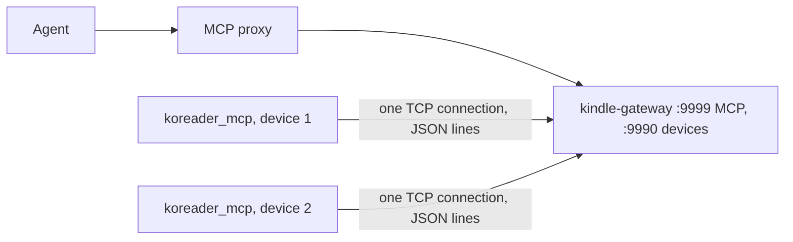

# Device bridge

An agent talks MCP to `kindle-gateway` (Node, port 9999 by default). `koreader_mcp` (Lua, inside KOReader) dials out to the gateway's `DEVICE_PORT` (9990 by default) during a live session and keeps that one connection open; tool calls and replies travel over it. A device is in `list_devices` exactly while its connection is open, and the gateway keeps the list in memory only. Devices listen on nothing.

## The connection

Newline-delimited JSON. The device sends a hello (`name`, `id_hash`, versions); the gateway answers `welcome` or `refused`. Then the gateway sends JSON-RPC calls and the device replies by id, in any order. The device pings every 60 s and the gateway pongs; either side treats 150 s of silence as a drop.

- A name is refused only while a different `id_hash` holds it on an open connection. The same hash replaces the old connection, which covers a reconnect the gateway has not noticed yet.
- `id_hash` is the first 12 hex digits of a SHA-256 of the serial; the serial itself never leaves the device, only its last 4 characters in the default name `pw3-XXXX`.
- A session starts from the menu (Agent bridge, Live mode) and ends on 15 minutes without an agent command, battery below 30%, the menu, or failing to reconnect after 5 s, 15 s and 60 s. `session_open` in `<settings>/koreader_mcp.lua` resumes a session after a kill. `live_mode = "always"` (the emulator) never ends and retries every 60 s.
- During a session on a Kindle: `preventScreenSaver` is held and KOReader's WiFi auto-off check is paused; both are put back at the end. The socket is checked every 0.2 s within 10 s of an agent command, else every 2 s.
- The socket is `FD_CLOEXEC`: otherwise the detached restart shell inherits it and the gateway never sees the device go.
- Connecting blocks the UI for up to 5 s per attempt; accepted because it only happens during a session.

Line numbers below are a starting point, not an address: jump roughly there, confirm by what the code says, and fix and re-date this page if a range is off by more than a screen.

| file | lines | what lives there |
|---|---|---|
| `kindle-gateway/src/gateway-server.ts` | 1-35 | env (`PLUGINS_SRC`, `EINK_DELAY`) and screenshot resize |
| same | 56-235 | `/health` and tool definitions (21 tools) |
| same | 241-262 | stateless MCP transport on `/mcp` |
| same | 273-469 | `forwardToolCall`, `forwardWithScreenshot`, `uiCall`, diagnostics tools, `captureScreenshotTool` |
| same | 470-507 | `restartKoreader` |
| same | 508-625 | `deployPlugin` (see the deploy pipeline page) |
| `kindle-gateway/src/device-link.ts` | whole file | one device connection: framing, reply routing, ping, silence timer, hello; `startDeviceListener` |
| `kindle-gateway/src/device-registry.ts` | whole file | connected devices, in memory; `attach`, `waitForConnection` |
| `koreader_mcp.koplugin/handlers.lua` | whole file | one `handlers.<tool>` per tool, `dispatch` at the end |
| `koreader_mcp.koplugin/live.lua` | whole file | session state machine, with everything device-specific injected, tested by `test_live.lua` on plain luajit |
| `koreader_mcp.koplugin/main.lua` | 65-174 | what `live.lua` is given: identity, connect, screen saver, WiFi check |
| same | 198-228, 295-395 | plugin init, resume, menu |
| same | 229-294 | Send diagnostics: inbox address, manifest info, build and upload |
| `koreader_mcp.koplugin/diagnostics.lua` | whole file | bundle build, redaction, log offset, upload; tested by `test_diagnostics.lua` |
| `koreader_mcp.koplugin/server.lua` | whole file | supplies the JSON codec; its HTTP listener is no longer started |

## Tool groups

- Base: `list_devices`, `read_files`, `run_command`, `device_status`
- UI (each returns a screenshot with the result): `get_current_view`, `get_menu_items`, `select_menu_item`, `go_back`, `close_top_widget`, `send_event`
- Snapshot and input: `snapshot`, `tap`, `hold`, `tap_text`, `type`, `action`
- Device management: `screenshot`, `restart_koreader`, `deploy_plugin`
- Diagnostics, read from the inbox folder so they work while the device is offline: `list_diagnostics`, `read_diagnostics` (`kindle-gateway/src/diagnostics.ts`)

## Send diagnostics

A menu button (Tools, "Send diagnostics") in `koreader_mcp.koplugin` that works with live mode off. 0.5 s after the tap, `diagnostics.lua` builds one `.tar.gz` (`manifest.json` with versions, `crash.log` lines since the last send, `snapshot.json`, `screenshot.png`) and PUTs it over HTTP to `/inbox/<device name>/<UTC stamp>.tar.gz` on the gateway host, port 9999 (`inbox_url` in `<settings>/koreader_mcp.lua` or `config.lua` replaces the whole address).

- The `crash.log` offset is kept in `<settings>/koreader_mcp_diagnostics_offset.txt`, never in `settings.reader.lua`, and moves only after a 201, so a failed send repeats its lines.
- Text parts pass `redact()`: the `/proc/usid` serial, `password=`/`token=`-style values, `user:pass@` in URLs, `Authorization` and `Cookie`. Input field text in the snapshot is dropped. The screenshot cannot be filtered.
- The bundle is built with the shell's `tar -czf` into `/tmp`.

## Screenshot in every UI response

After a UI tool runs, the gateway waits `EINK_DELAY` ms (default 1500) for the e-ink refresh, calls `capture_screenshot` on the device (framebuffer grab, base64, temp files removed), resizes 1072x1448 to 536x724 JPEG quality 50 with `sharp` (about 20KB) and returns a text block plus a native image block.

## Deliberate choices

- The MCP transport is stateless: no `mcp-session-id` is issued and any sent is ignored, so a gateway restart never strands the proxy on a dead session (decision record 0004).
- Devices dial out and run no listener (decision record 0005).

## Running on Android

`koreader_mcp.koplugin` should load in KOReader for Android: copy it to `koreader/plugins/` on internal storage, restart KOReader and start Live mode from the menu. The dial-out path has not been run on Android. Known differences from a Kindle:

- `capture_screenshot` fails with `Screen:shot failed: nil`: it writes to `/tmp`, which Android apps cannot write to.
- `restart_koreader` and `deploy_plugin` assume Kindle paths.

Set `device_name` in the plugin's `config.lua` or use Rename device, otherwise it connects as `koreader` (there is no `/proc/usid`).
