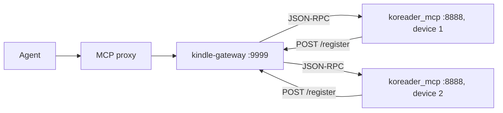

# Device bridge

An agent talks MCP to `kindle-gateway` (Node, port 9999 by default). The gateway forwards JSON-RPC to `koreader_mcp` (Lua, port 8888) inside KOReader on each Kindle. Each Kindle announces itself by `POST /register` to the gateway when WiFi connects, and the gateway keeps the list in memory only.

Line numbers below are a starting point, not an address: jump roughly there, confirm by what the code says, and fix and re-date this page if a range is off by more than a screen.

| file | lines | what lives there |
|---|---|---|
| `kindle-gateway/src/gateway-server.ts` | 1-35 | env (`PLUGINS_SRC`, `EINK_DELAY`) and screenshot resize |
| same | 51-176 | `/register`, `/health` and tool definitions (13 tools) |
| same | 178-205 | stateless MCP transport on `/mcp` |
| same | 214-328 | `forwardToolCall`, `forwardWithScreenshot`, `captureScreenshotTool` |
| same | 329-383 | `restartKoreader` |
| same | 384-505 | `deployPlugin` (see the deploy pipeline page) |
| `kindle-gateway/src/device-registry.ts` | whole file | in-memory registry, cleared on container recreate |
| `koreader_mcp.koplugin/handlers.lua` | 14-340 | one `handlers.<tool>` per base and UI tool, `dispatch` at the end |
| `koreader_mcp.koplugin/server.lua` | 169-322 | socket bind, `FD_CLOEXEC`, HTTP and JSON-RPC loop |
| `koreader_mcp.koplugin/main.lua` | 43-167 | plugin init, firewall rule, phone-home on network connect |

## Tool groups

- Base: `list_devices`, `read_files`, `run_command`, `device_status`
- UI (each returns a screenshot with the result): `get_current_view`, `get_menu_items`, `select_menu_item`, `go_back`, `close_top_widget`, `send_event`
- Device management: `screenshot`, `restart_koreader`, `deploy_plugin`

## Screenshot in every UI response

After a UI tool runs, the gateway waits `EINK_DELAY` ms (default 1500) for the e-ink refresh, calls `capture_screenshot` on the device (framebuffer grab, base64, temp files removed), resizes 1072x1448 to 536x724 JPEG quality 50 with `sharp` (about 20KB) and returns a text block plus a native image block.

## Deliberate choices

- The MCP transport is stateless: no `mcp-session-id` is issued and any sent is ignored, so a gateway restart never strands the proxy on a dead session (decision record 0004).
- Navigation uses `send_event` (KOReader events), never raw touch injection; see the traps catalogue.
- The device server binds `0.0.0.0` and opens its own firewall rule on startup, because the Kindle firewall drops unknown ports.

## Running on Android

`koreader_mcp.koplugin` loads in KOReader for Android unchanged: copy it to `koreader/plugins/` on internal storage and restart KOReader. Base and UI tools work. Three things differ from a Kindle:

- It never phones home on its own, because Android starts KOReader with WiFi already up and `onNetworkConnected` never fires; register it by hand (see the trap about a Kindle that stays offline).
- `capture_screenshot` fails with `Screen:shot failed: nil`: it writes to `/tmp`, which Android apps cannot write to.
- The Kindle firewall rule at startup fails harmlessly, and `restart_koreader` and `deploy_plugin` assume Kindle paths.

Set `device_name` in the plugin's `config.lua`, otherwise it registers as `kindle-unknown` (Android sets no `HOSTNAME`).
