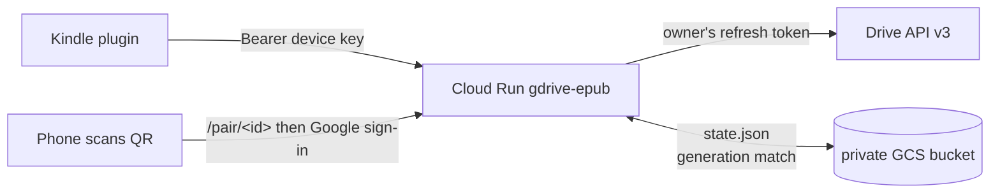

# Google Drive to EPUB server

`gdriveepub-server/` is a Starlette app (Python 3.12, uv) deployed to Cloud Run as service `gdrive-epub`. Why it exists, and why the Kindle does not talk to Google itself: decision record 0007. Setup from a clean project: `gdriveepub-server/README.md`.

## Files

| file | owns |
|---|---|
| `src/gdriveepub/app.py` | every route, error shapes, the download path (export to a temp file, clean file to file, stream chunked; PDF/EPUB streamed unchanged) |
| `src/gdriveepub/config.py` | settings from the environment; refuses `DEV_ACCESS_TOKEN` and `DEV_DEVICE_KEY` when `K_SERVICE` is set (Cloud Run) |
| `src/gdriveepub/pairing.py` | pairing, device keys and the signed OAuth `state`, as pure functions on the state dict |
| `src/gdriveepub/store.py` | the state object: memory, local file, or GCS with generation-match retries |
| `src/gdriveepub/google.py` | OAuth code exchange and token refresh (`invalid_grant` becomes re-auth), Drive list, metadata, export (10 MB cap), the EPUB `exportLinks` URL for larger Docs, and media |
| `src/gdriveepub/driveq.py` | `/api/files` query parameters to a Drive `q` and `orderBy` |
| `src/gdriveepub/names.py` | file names: sanitised title, `Content-Disposition`, percent-encoded `X-File-Name` |
| `src/gdriveepub/epubclean.py` | the EPUB cleanup |
| `deploy.sh` | idempotent setup (service account, bucket, roles) and `gcloud run deploy --source .`, from a gitignored `.env` |

## HTTP contract

All JSON; errors are `{"error": "<code>", "message": "..."}`.

| method + path | auth | answer |
|---|---|---|
| `GET /health` | none | `{"status":"ok","version":"x.y.z"}` |
| `POST /pair/start` | none | `{"pair_id","poll_secret","url","expires_in":600}`; `url` is `<BASE_URL>/pair/<pair_id>`, shown as a QR code |
| `GET /pair/<pair_id>` | none | 302 to Google sign-in with `state` signed for this pairing (no `login_hint`, the account chooser is not prefilled); 404 page if expired |
| `GET /auth/callback` | Google | exchanges the code; 403 unless the id token's `aud` is our client, the email is verified and its SHA-256 (lowercased) is in `OWNER_EMAIL_SHA256`; stores the refresh token and only the hash of the email; approves the pairing |
| `GET /pair/<pair_id>/poll?secret=` | poll secret | `{"status":"pending"}`, then once `{"status":"approved","device_key":"..."}`; 403 `bad_secret`, 404 `pairing_expired` |
| `GET /reauth` | none | Google sign-in without a pairing, to renew a dead refresh token |
| `GET /api/status` | device key | `{"google":"ok"}` or `{"google":"reauth_needed","signin_url":...}` |
| `GET /api/files` | device key | `{"files":[{"id","name","kind","modified_time","created_time","viewed_time","size"}],"next_page_token"}` |
| `GET /api/files/<id>/download` | device key | the file, chunked with no `Content-Length`; `Content-Disposition`, `X-File-Name` (percent-encoded UTF-8), `X-Modified-Time`. Docs over 10 MB go through the EPUB `exportLinks` URL; Google can take 30 s or more before the first byte, and nothing is sent until cleanup ends |

`/api/files` takes `view=recent|search`, `q`, `modified_within` and `created_within` (`1d`, `1w`, `1m` = 30 days, `3m` = 91 days), `sort=viewed|modified|created|name`, `page_token`, `page_size` (default 25, max 100). Only Google Docs, PDFs and EPUBs that are not trashed. Drive cannot order full-text searches, so in `view=search` the sort applies within a page only.

Other errors: `401 device_unauthorized`, `401 google_reauth` (with `signin_url`), `400 bad_request` (with `field`), `404 not_found`, `413 too_large` (over 10 MB and Drive gave no EPUB export link), `415 unsupported`, `502 google_error`.

## State

One JSON object (`STATE_OBJECT`, default `gdrive-epub/state.json`) in `STATE_BUCKET`: the Google refresh token and account, the SHA-256 of every device key, and pending pairings (10 minutes). Every change is read, modified and written with `ifGenerationMatch`, retried on conflict. Revoke a Kindle by deleting its entry from `device_keys`; revoke everything by deleting the object.

## EPUB cleanup

Google writes every style inline, and inline styles beat a stylesheet, so `epubclean.py` removes the spacing properties (padding, margins, heights, line heights, font sizes and families) from inline styles and injects one small stylesheet. It also drops empty paragraphs (but keeps a blank line inside a code block), marks paragraphs whose text is all monospace as code lines, unpins image sizes, and removes the remote font `@import` (the Kindle has no network fonts). Text, images, tables, links, lists and emphasis are kept. A page it cannot parse is left as Google wrote it, and if cleanup fails the raw export is served.

## Tests and local runs

- `cd gdriveepub-server && uv run pytest -q`: pure logic, the cleanup against a synthetic EPUB (`tests/fixtures/synthetic-epub/`, zipped by `tests/conftest.py`), and HTTP tests of the real app with Google faked through `httpx.MockTransport` (`tests/test_http.py`).
- Local server against real Drive data: set `DEV_ACCESS_TOKEN` (a Google access token with Drive read access), `DEV_QUOTA_PROJECT` if the token is a gcloud user token, `DEV_DEVICE_KEY`, `BASE_URL`, `OWNER_EMAIL_SHA256` and `STATE_FILE`, then `uv run gdriveepub` (port `PORT`, default 8080).
