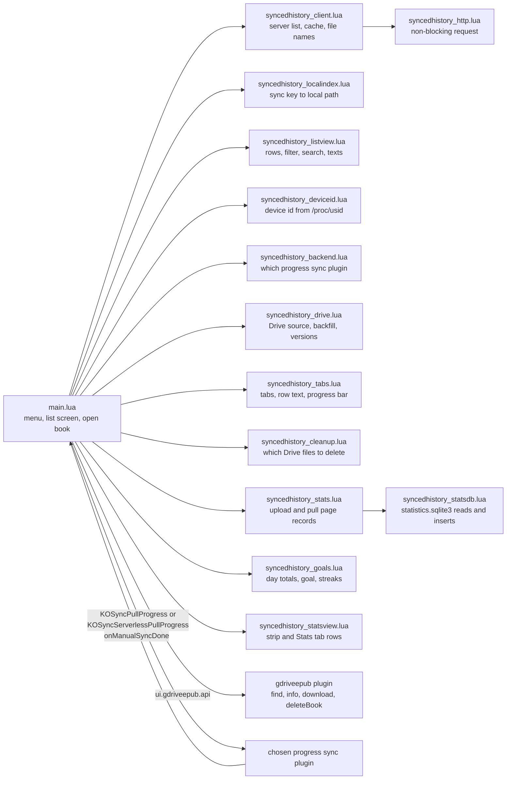
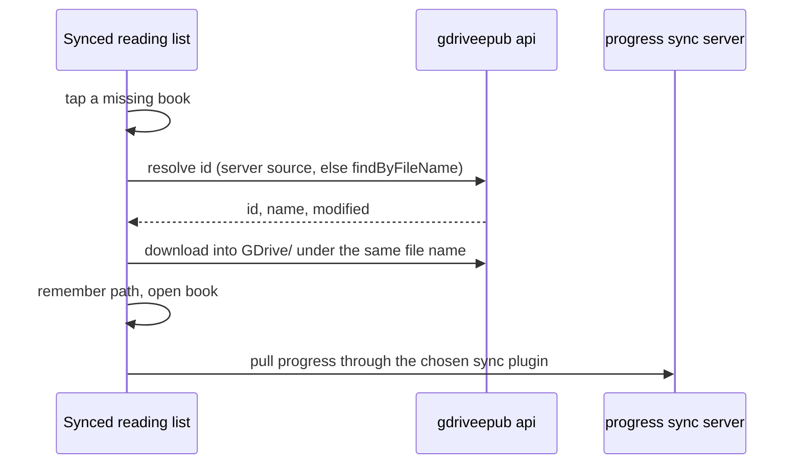

# Synced reading list

`syncedhistory.koplugin/` adds one main-menu entry, "Synced reading list". It shows every book with progress on the progress sync server that the chosen progress sync plugin is logged into, using that plugin's server and login: KOReader's built-in progress sync (`kosync.koplugin`) or "Progress sync serverless" (`kosyncserverless.koplugin`), picked by the setting `progress_sync_backend` (`auto`, the default, takes the serverless one when it is loaded; `kosync`; `serverless`). A second entry under Tools, "Synced reading list backend", changes it. The server needs three extra routes: `GET /syncs/list` (a book saved under several file names comes back as one item whose `aliases` list every key, newest first), `PUT /syncs/documents` and `DELETE /syncs/documents/{document}`. Each module except `main.lua` takes its KOReader dependencies as arguments, so its test runs under plain `luajit` outside KOReader.

Line numbers below are a starting point, not an address: jump roughly there, confirm by what the code says, and fix and re-date this page if a range is off by more than a screen.

| file | lines | what lives there |
|---|---|---|
| `syncedhistory.koplugin/main.lua` | 45-62 | at file load, before any plugin instance: the progress sync device id from the Kindle serial (`syncedhistory_serial_path` in the reader settings points at a fake serial on the emulator) |
| same | 63-175 | one settings object, the local index and the client, all kept for the whole run; `hasPlugin` (`ui.<name>` while a book is open, else `PluginLoader.enabled_plugins`), `getBackend`, reading the chosen plugin's login (live table, `settings/kosync.lua` or `settings/kosyncserverless.lua`, or for the built-in one the global `kosync` key up to v2024.11) |
| same | 251-289 | Dispatcher action `synced_reading_list` ("Synced reading list" under General in the gesture manager) and its `ShowSyncedReadingList` event |
| same | 290-364 | `pullProgress`, `pushDocument` helper (sends the Drive source, shows the clash message), `onReaderReady` (pushes the file name, pulls once for a book opened from the list, or after a Drive reload jumps to the saved percentage and pushes) |
| same | 365-419 | `updateFromDrive` (asks Drive for the file's `modified`, downloads over the same path when newer), `shouldCheck` (paired, online, has a Drive record, not checked in the last 60 s), `checkDriveVersion(done)` (called by the progress sync's manual push and pull) |
| same | 420-521 | `openRow` (opens whichever alias is local; else offers the Drive download when `ui.gdriveepub.api` exists), `downloadRow` (waits for the network, resolves the Drive id, downloads into `GDrive/`, adds the path to the local index, opens), `openPath` |
| same | 522-599 | `cleanupDrive` (lists the GDrive folder, reads each sidecar, logs every keep and removal, deletes through `api.deleteBook`, toast), `removeBookFromList(path, done)` (for other plugins: one DELETE per key of the book, online only), `onManualSyncDone` (fresh fetch, then cleanup) |
| same | 600-777 | `localTitle` (sidecar `doc_props.title`, cached per path), "show books not on this device" setting (`show_missing`, per device), `redrawList` (tabs, row text, subtitle starting with the tab name), `fetchIntoList` (runs the cleanup once, on the list's first fetch) |
| same | 778-933 | `refreshList` (forced local rescan, then a refetch), search dialog, title-bar menu (first row New / Recent / Old with counts, current one marked `✓`; filter, search, Refresh), `removeRow` (confirm, one DELETE per alias, refetch), long-press pop-up with `Open` only for books on this device and `Remove from list` for every book |
| same | 934-1019 | `showList` (cached copy at once, then the server's copy; 8 rows a page at font 16; closing saves `list_last_seen`), `startBackfill` (once per run, 2 s after the list opens) |
| same | 1020-end | the backend submenu, the reading goals submenu and the menu entries |
| `syncedhistory.koplugin/syncedhistory_tabs.lua` | all | `Tabs.split` (sets `row.is_new`), `Tabs.relative` ("2h ago"), `Tabs.bar` (block characters), `Tabs.rowText` (marks, name, device, relative time; right side the bar, or `⬇ Drive` and the bar for a missing Drive book) |
| `syncedhistory.koplugin/syncedhistory_cleanup.lua` | all | `Cleanup.decide` (which files to delete and why each other stays), `Cleanup.facts` (opened, annotation count from a sidecar), `Cleanup.message` |
| `gdriveepub.koplugin/main.lua` | 462-535 | `api.deleteBook(path)`: only a file directly in the GDrive folder, never the open book; reuses the Downloads screen's delete |
| `syncedhistory.koplugin/syncedhistory_drive.lua` | all | ISO time parsing and `isNewer`, `resolve` (the server's source id first, else exactly one Drive file with the same name), `sourceFor`, `clash`, `backfillRecord` and the sequential `backfill` (one request every 0.5 s) |
| `syncedhistory.koplugin/syncedhistory_backend.lua` | all | `Backend.resolve(choice, has_plugin, log)`: the one place the choice becomes a module name, settings file and pull event; `serverless` chosen but not loaded falls back to the built-in plugin with one log line per run; `fromSources` does the same for the `--koreader` tests by which plugin folders exist |
| `syncedhistory.koplugin/syncedhistory_listview.lua` | 78-208 | `ListView.deviceLabel` (model plus last 4 characters of the device id), `ListView.aliases` and `ListView.localMatch` (a row is local when any alias key is in the index), `ListView.rows`: newest first, percentage, device, on-device or missing |
| same | 210-282 | `ListView.view` (filter, then case-insensitive plain-text search), `subtitle`, `emptyText` |
| same | 284-end | `ListView.details`: the long-press text; `ListView.removeText`: the remove confirm |
| `syncedhistory.koplugin/syncedhistory_client.lua` | 99-158 | credentials from the progress sync login, request headers, `cleanRow` (no JSON null in the cache, `aliases` included) |
| same | 93-102 | `bookKeys(path, content_md5)`: every key a book can sit under (md5 of the file name, plus the sidecar's content md5 when it differs) |
| same | 160-end | cached list, `fetchList`, `cachedSource`, `pushDocument` (tells the server a book's file name and Drive source; drops the source and flags a clash when the server already holds another Drive id for that name), `removeDocuments` (one DELETE per key; the cache drops the book only when every key went) |
| `syncedhistory.koplugin/syncedhistory_http.lua` | 91-end | request without blocking the UI, polled with `scheduleIn` |
| `syncedhistory.koplugin/syncedhistory_deviceid.lua` | 33-end | `derive` (uppercase md5 of `kosync:` plus the serial), `apply` (writes and flushes only when it differs; never logs the serial) |
| `syncedhistory.koplugin/syncedhistory_localindex.lua` | 116-215 | scan of the home folder, `rescan` (automatic at most once per run on a lookup miss; the list's Refresh calls it directly), `lookup` of a sync key, `paths` (every indexed file, for the backfill), `remember` (adds a just-downloaded file without a rescan) |
| `kosyncserverless.koplugin/kosyncserverless_version.lua` | all | `Version.decide(local, server, server_ts, local_ts)`: `pull` when versions match or either is unknown, `percent` when the server's progress was saved on another version and is newer, `keep_local` otherwise |
| `kosyncserverless.koplugin/main.lua` | 785-1060 | `doc_version` in every progress push, `manualSync(push)` behind both menu items and both Dispatcher events (runs `checkDriveVersion` first when the synced reading list is loaded; marks the sync as manual), `manualSyncDone(ok)` (after a successful interactive push or pull, calls `ui.syncedhistory:onManualSyncDone()`), version-aware branch of the interactive pull, first push when the server has no progress and the book has a version |
| same | 1363-1384 | `onCloseWidget`: a Drive doc marked read while open is decided again from the saved sidecar 1 s after the reader closes |
| same | 1386-end | marked as read: `removeDriveDoc` (through `api.deleteBook`, toast), `afterPush` (list removal, then `onManualSyncDone`, then the Drive action), `sendOrQueue`, `pushMarkedRead` (open book), `pushClosedMarkedRead` (key and position from the sidecar), `installStatusHook` (wraps `BookList.setBookInfoCacheProperty` once per process) |
| `kosyncserverless.koplugin/kosyncserverless_markread.lua` | all | `isTransition` (into `complete` only), `enabled`, `digest`, `position`, `driveAction` (`none`, `keep`, `after_close`, `delete`), `removeFromList` (Drive docs only) |

## Drive books

A book downloaded by the `gdriveepub` plugin keeps `gdriveepub_source = {id, modified, downloaded_at}` in its sidecar. That source travels with the book's file name in `PUT /syncs/documents`, so another device can fetch the same file.

- **Backfill.** Once per run, 2 s after the list opens, every indexed book whose sidecar has no Drive source is looked up by exact file name, one request every 0.5 s; exactly one match writes the source into the sidecar and pushes it, zero or several matches skip the book until the next run. A book with a source is never searched again, so a push that failed (offline, bad login) reaches the server only the next time the book is opened.
- **Versions.** Each progress push sends `doc_version` (the Drive `modified` time). Opening from the list, or a manual push or pull, first asks Drive for a newer version; if there is one the file is replaced, reopened with `switchDocument`, and the saved percentage is restored. A pull of progress saved on an older version moves by percentage instead of the stored position.

Checked live on the KOReader emulator: a missing Drive book with a source on the server downloaded into `GDrive/`, got its sidecar source, opened and pulled progress; the backfill matched three local Drive books through `findByFileName`; the gesture action appears under General and opens the list. The newer-version reload (`switchDocument` on the same path, `GotoPercent`) was not exercised live.

## Tabs

The title-bar menu's first row switches between four tabs (New, Recent, Old, Stats), each with its count; the subtitle starts with the tab name, but its book count is for the whole list.

- **New**: the latest push came from another device after `list_last_seen`, the time the list was last closed on this device (saved in the plugin settings). Such a row is marked `●`. A New book also appears in Recent or Old.
- **Recent**: pushed in the last 7 days.
- **Old**: the rest, finished books last (marked `✓`).

KOReader's `MenuItem` turns every newline in an item's text into a space (`frontend/ui/widget/menu.lua`, near line 211), so a row cannot be split into a name line and a device line: `Tabs.rowText` joins them with ` · ` and the menu wraps. At the default font for 8 rows (22) a long name used both lines and cut the device off, so the menu sets `items_font_size = 16`, which fits three lines. The glyphs `●`, `✓`, `⬇`, `█` and `░` are not in Noto Sans; they render from KOReader's FreeSans fallback.

## Drive cleanup

A downloaded Drive doc is removed once it is done with: a file directly in `GDrive/` that was opened on this device and is no longer on the reading list. Every other file stays, and the log says why:

| kept because | log reason |
|---|---|
| any alias of it is on the list | `still in the reading list` |
| it is the book open in the reader | `open in the reader` |
| no sidecar | `no reading data` |
| sidecar without `percent_finished`, `last_xpointer` or `last_page` (a download writes none of these) | `never opened on this device` |
| highlights, notes or bookmarks (`annotations`, or the older `highlight` and `bookmarks`) | `has highlights, notes or bookmarks` |

Nothing is deleted unless the list was just fetched from the server: a cached or failed fetch refuses the whole run. Triggers: once per run on the list's first fetch, and after every successful manual push or pull in "Progress sync serverless" (`onManualSyncDone`, which fetches fresh first). Removed files show one toast, "Removed N finished Drive docs".

The backfill runs right after the first fetch and works from the local index read before the cleanup, so it can meet a file the cleanup just deleted; it skips such a file (`file is gone`). Before that check it crashed KOReader, because `lfs.attributes` on a missing file returns `nil` plus a message and the message reached `backfillRecord` as the download time.

Checked live on the emulator on 2026-11-21: the first open removed four opened Drive docs no longer on the list, kept a never-opened download and the one book still listed, and the backfill then skipped the four gone files without crashing.

Marking a Drive doc as read (next section) also cleans it up, without waiting for the list: after the 100% push it is removed from the list under every key (`removeBookFromList`, md5 of the file name plus the content md5), and its file is deleted through `api.deleteBook` unless it has highlights, notes or bookmarks. When it is open, the delete waits until the reader closes and is decided again from the saved sidecar, so a highlight made after marking read keeps the file. The server's `DELETE /syncs/documents/{document}` also drops that key's progress, so the 100% just pushed goes with the list entry; this is accepted. Reading stats are never touched: the `statistics.sqlite3` rows, the server's `/stats/records` and the `gdrive` kind all stay.

## Mark as read

KOReader sends no event when a book's status changes, but every change goes through `BookList.setBookInfoCacheProperty(file, "status", value)`. `kosyncserverless.koplugin` wraps that function once per process and acts on a change into `complete` only, on the next tick, after the caller has saved the sidecar. Entry points this covers: the end-of-book dialog and auto-mark, the book status screen, and the long-press "Finished" buttons of the file browser and history, including multi-select.

- **Push.** An open book pushes its current position at 100%. A closed book is keyed from its sidecar the way the reader keys it (file name md5 or `partial_md5_checksum`) and sends its saved position; a book never opened has none and is skipped.
- **Setting.** "Push 100% when marked as read" in the progress sync menu, key `mark_read_push`, on unless set to `false`.
- **Offline.** Wi-Fi is never turned on: the push goes to the retry queue and the list removal is skipped, so a Drive doc marked read offline stays on the list and is cleaned up later by the usual cleanup.

Checked live on the emulator on 2026-11-22 with a faked Drive doc: the 100% push, removal from `/syncs/list` under both keys, the file deleted on close, and its stats rows kept.

## Reading goals and stats

Reading time is KOReader's own statistics: the page records (`page_stat_data`) in `statistics.sqlite3`, not progress pushes. `syncedhistory_stats.lua` uploads this device's new rows with `PUT /stats/records` (at most 1000 per request; the server answers 413 code 2008 above that, and 403 code 2003 for the whole batch if one record is bad), then pulls other devices' rows with `GET /stats/records?since=<cursor>&exclude_device_id=<id>` until `more` is false and inserts them into the local database, so KOReader's own calendar and statistics show them too. Rows it inserted itself are stepped past by the upload mark and never go back up. Both marks (`stats_marks`, per server and user) live in the plugin settings. The cursor is set to whatever `next` the server returns, even below `since`: a server whose database was reset starts its sequence again.

The sync runs only when the network is already up, never by turning Wi-Fi on: when the list opens, on Refresh, 3 s after a book opens (`onReaderReady`) and after a manual push or pull in "Progress sync serverless". The log line is `syncedhistory: stats sync done ... up N down M`.

Each record can carry a `kind` (`^[a-z0-9_]{1,32}$`, else the server rejects the batch). A Drive doc is recorded in `stats_local_kinds` when it is opened with a `gdriveepub_source` sidecar, and its records go up with `kind = "gdrive"`; books send none. `GET /stats/kinds` returns the kind of every document any device sent one for (`stats_kinds`), which is how another device's Drive docs are classed. A Drive doc read before this existed and not opened since counts as a Book until it is opened again.

The goal strip ("Today 12 / 60 min ... Week ...") is the first list row on page 1 of every tab; tapping it opens the Stats tab at this week. The Stats tab lists one week's days with prev and next week rows, the month total against the goal, days met and the best streak, time by kind, the top books of the month, and "Open calendar". When the goal is met a message shows once a day, on opening the list.

Settings, under Tools: "Reading goals" (Daily goal, Week starts on, Count kinds toward goal, Show goal strip on list, Sync reading stats now) and "Open calendar", which broadcasts `ShowCalendarView` to the statistics plugin and works from the file browser. Keys: `stats_goal_min`, `stats_week_start`, `stats_counted`, `stats_show_strip`.

Checked live on the emulator on 2026-11-22 against a test server: the first sync uploaded 42 local rows, a record pushed from a second device id with `kind = "gdrive"` showed up after Refresh in the strip, under "Drive docs" in the Stats tab, and in KOReader's calendar.

## Tests

`test_localindex.lua`, `test_client.lua`, `test_listview.lua`, `test_deviceid.lua`, `test_backend.lua`, `test_drive.lua`, `test_cleanup.lua` (cleanup and tabs), `test_stats.lua`, `test_statsdb.lua` (against a real SQLite file under KOReader's `luajit`), `test_goals.lua` and `test_statsview.lua` sit next to the modules; the mark-as-read decisions are tested by `kosyncserverless.koplugin/test_markread.lua`. Run each with `luajit <file>`, or on a device or the emulator with `--koreader` from the KOReader install folder, which uses the real md5 and lfs. `test_backend.lua` loads `main.lua` itself with KOReader modules faked, including `dispatcher`; unknown KOReader modules load as stubs. In `--koreader` mode, `test_listview.lua` and `test_localindex.lua` read the chosen progress sync plugin's source (`SYNCEDHISTORY_BACKEND=auto|kosync|serverless`, default `auto`), looked for in `plugins/` and next to this plugin's folder. The plugin is checked on KOReader `v2024.11`, `v2025.04` and `v2026.07.1`. When you use a KOReader API, look it up in `v2024.11` first: that is the oldest version supported, and `main.lua` already works around `filemanagerutil.openFile` being missing there.

## Deliberate choices

- Opening a book goes through the chosen progress sync plugin's own "pull progress" event, not a jump the plugin makes itself, so the same rules apply as when you pull by hand.
- The search is never saved and lasts only as long as one opening of the list. The "show books not on this device" choice is saved per device.
- The device id is replaced at every start from `/proc/usid`, not kept from the settings file, because a restored settings file gives two Kindles one id and the built-in sync then won't pull between them. Without `/proc/usid` (Android, the emulator) nothing changes.
