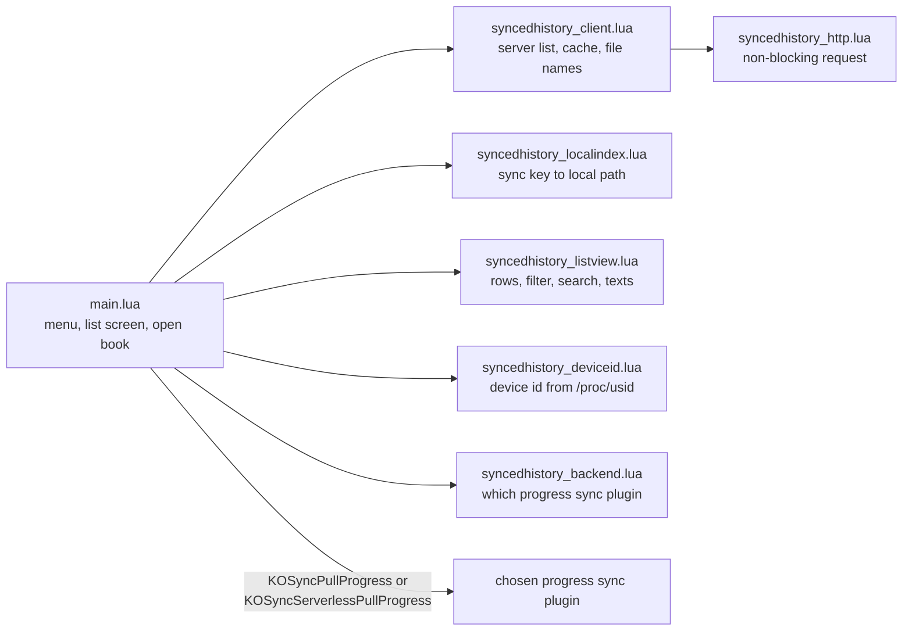

# Synced reading list

`syncedhistory.koplugin/` adds one main-menu entry, "Synced reading list". It shows every book with progress on the progress sync server that the chosen progress sync plugin is logged into, using that plugin's server and login: KOReader's built-in progress sync (`kosync.koplugin`) or "Progress sync serverless" (`kosyncserverless.koplugin`), picked by the setting `progress_sync_backend` (`auto`, the default, takes the serverless one when it is loaded; `kosync`; `serverless`). A second entry under Tools, "Synced reading list backend", changes it. The server needs three extra routes: `GET /syncs/list` (a book saved under several file names comes back as one item whose `aliases` list every key, newest first), `PUT /syncs/documents` and `DELETE /syncs/documents/{document}`. Each module except `main.lua` takes its KOReader dependencies as arguments, so its test runs under plain `luajit` outside KOReader.

Line numbers below are a starting point, not an address: jump roughly there, confirm by what the code says, and fix and re-date this page if a range is off by more than a screen.

| file | lines | what lives there |
|---|---|---|
| `syncedhistory.koplugin/main.lua` | 32-47 | at file load, before any plugin instance: the progress sync device id from the Kindle serial (`syncedhistory_serial_path` in the reader settings points at a fake serial on the emulator) |
| same | 51-158 | one settings object, the local index and the client, all kept for the whole run; `hasPlugin` (`ui.<name>` while a book is open, else `PluginLoader.enabled_plugins`), `getBackend`, reading the chosen plugin's login (live table, `settings/kosync.lua` or `settings/kosyncserverless.lua`, or for the built-in one the global `kosync` key up to v2024.11) |
| same | 170-243 | `pullProgress`, `onReaderReady` (pushes the file name, pulls once for a book opened from the list), `openRow` (opens whichever alias is local) |
| same | 245-318 | "show books not on this device" setting (`show_missing`, per device), `redrawList`, `fetchIntoList`, `refreshList` (forced local rescan, then a refetch) |
| same | 320-452 | search dialog, title-bar menu (filter, search, Refresh), `removeRow` (confirm, one DELETE per alias, refetch), long-press pop-up with `Open` only for books on this device and `Remove from list` for every book |
| same | 454-end | `showList` (cached copy at once, then the server's copy), the backend submenu and the menu entries |
| `syncedhistory.koplugin/syncedhistory_backend.lua` | all | `Backend.resolve(choice, has_plugin, log)`: the one place the choice becomes a module name, settings file and pull event; `serverless` chosen but not loaded falls back to the built-in plugin with one log line per run; `fromSources` does the same for the `--koreader` tests by which plugin folders exist |
| `syncedhistory.koplugin/syncedhistory_listview.lua` | 78-208 | `ListView.deviceLabel` (model plus last 4 characters of the device id), `ListView.aliases` and `ListView.localMatch` (a row is local when any alias key is in the index), `ListView.rows`: newest first, percentage, device, on-device or missing |
| same | 210-282 | `ListView.view` (filter, then case-insensitive plain-text search), `subtitle`, `emptyText` |
| same | 284-end | `ListView.details`: the long-press text; `ListView.removeText`: the remove confirm |
| `syncedhistory.koplugin/syncedhistory_client.lua` | 99-158 | credentials from the progress sync login, request headers, `cleanRow` (no JSON null in the cache, `aliases` included) |
| same | 160-end | cached list, `fetchList`, `pushDocument` (tells the server a book's file name), `removeDocuments` (one DELETE per key; the cache drops the book only when every key went) |
| `syncedhistory.koplugin/syncedhistory_http.lua` | 91-end | request without blocking the UI, polled with `scheduleIn` |
| `syncedhistory.koplugin/syncedhistory_deviceid.lua` | 33-end | `derive` (uppercase md5 of `kosync:` plus the serial), `apply` (writes and flushes only when it differs; never logs the serial) |
| `syncedhistory.koplugin/syncedhistory_localindex.lua` | 116-200 | scan of the home folder, `rescan` (automatic at most once per run on a lookup miss; the list's Refresh calls it directly), `lookup` of a sync key |

## Tests

`test_localindex.lua`, `test_client.lua`, `test_listview.lua`, `test_deviceid.lua` and `test_backend.lua` sit next to the modules. Run each with `luajit <file>`, or on a device or the emulator with `--koreader` from the KOReader install folder, which uses the real md5 and lfs. `test_backend.lua` loads `main.lua` itself with every KOReader module faked. In `--koreader` mode, `test_listview.lua` and `test_localindex.lua` read the chosen progress sync plugin's source (`SYNCEDHISTORY_BACKEND=auto|kosync|serverless`, default `auto`), looked for in `plugins/` and next to this plugin's folder. The plugin is checked on KOReader `v2024.11`, `v2025.04` and `v2026.07.1`. When you use a KOReader API, look it up in `v2024.11` first: that is the oldest version supported, and `main.lua` already works around `filemanagerutil.openFile` being missing there.

## Deliberate choices

- Opening a book goes through the chosen progress sync plugin's own "pull progress" event, not a jump the plugin makes itself, so the same rules apply as when you pull by hand.
- The search is never saved and lasts only as long as one opening of the list. The "show books not on this device" choice is saved per device.
- The device id is replaced at every start from `/proc/usid`, not kept from the settings file, because a restored settings file gives two Kindles one id and the built-in sync then won't pull between them. Without `/proc/usid` (Android, the emulator) nothing changes.
