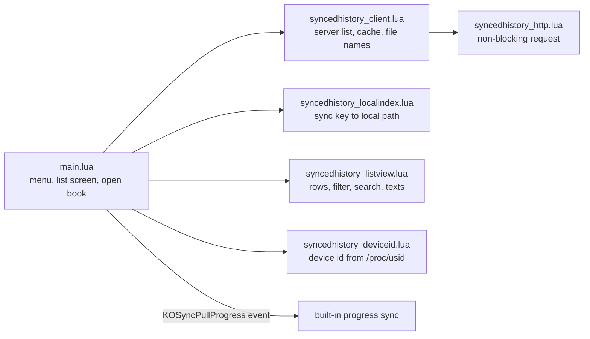

# Synced reading list

`syncedhistory.koplugin/` adds one main-menu entry, "Synced reading list". It shows every book with progress on the progress sync server that KOReader's built-in progress sync (`kosync.koplugin`) is logged into, using that plugin's server and login. The server needs two extra routes: `GET /syncs/list` and `PUT /syncs/documents`. Each module except `main.lua` takes its KOReader dependencies as arguments, so its test runs under plain `luajit` outside KOReader.

Line numbers below are a starting point, not an address: jump roughly there, confirm by what the code says, and fix and re-date this page if a range is off by more than a screen.

| file | lines | what lives there |
|---|---|---|
| `syncedhistory.koplugin/main.lua` | 32-47 | at file load, before any plugin instance: the progress sync device id from the Kindle serial (`syncedhistory_serial_path` in the reader settings points at a fake serial on the emulator) |
| same | 49-127 | one settings object, the local index and the client, all kept for the whole run; reading the progress sync login (live table, `settings/kosync.lua`, or the global `kosync` key up to v2024.11) |
| same | 142-202 | `pullProgress`, `onReaderReady` (pushes the file name, pulls once for a book opened from the list), `openRow` |
| same | 204-241 | "show books not on this device" setting (`show_missing`, per device) and `redrawList` |
| same | 243-339 | search dialog, title-bar menu, long-press pop-up with `Open` only for books on this device |
| same | 341-392 | `showList` (cached copy at once, then the server's copy) and the menu entry |
| `syncedhistory.koplugin/syncedhistory_listview.lua` | 72-148 | `ListView.deviceLabel` (model plus last 4 characters of the device id), `ListView.rows`: newest first, percentage, device, on-device or missing |
| same | 150-222 | `ListView.view` (filter, then case-insensitive plain-text search), `subtitle`, `emptyText` |
| same | 224-end | `ListView.details`: the long-press text |
| `syncedhistory.koplugin/syncedhistory_client.lua` | 94-123 | credentials from the progress sync login, request headers |
| same | 141-244 | cached list, `fetchList`, `pushDocument` (tells the server a book's file name) |
| `syncedhistory.koplugin/syncedhistory_http.lua` | 91-end | request without blocking the UI, polled with `scheduleIn` |
| `syncedhistory.koplugin/syncedhistory_deviceid.lua` | 33-end | `derive` (uppercase md5 of `kosync:` plus the serial), `apply` (writes and flushes only when it differs; never logs the serial) |
| `syncedhistory.koplugin/syncedhistory_localindex.lua` | 116-200 | scan of the home folder, `rescan` at most once per run, `lookup` of a sync key |

## Tests

`test_localindex.lua`, `test_client.lua`, `test_listview.lua` and `test_deviceid.lua` sit next to the modules. Run each with `luajit <file>`, or on a device or the emulator with `--koreader` from the KOReader install folder, which uses the real md5 and lfs. The plugin is checked on KOReader `v2024.11`, `v2025.04` and `v2026.07.1`. When you use a KOReader API, look it up in `v2024.11` first: that is the oldest version supported, and `main.lua` already works around `filemanagerutil.openFile` being missing there.

## Deliberate choices

- Opening a book goes through the built-in progress sync's own "pull progress" event, not a jump the plugin makes itself, so the same rules apply as when you pull by hand.
- The search is never saved and lasts only as long as one opening of the list. The "show books not on this device" choice is saved per device.
- The device id is replaced at every start from `/proc/usid`, not kept from the settings file, because a restored settings file gives two Kindles one id and the built-in sync then won't pull between them. Without `/proc/usid` (Android, the emulator) nothing changes.
